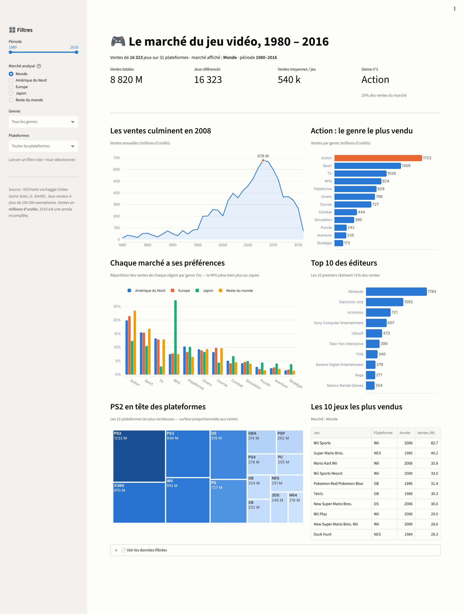

# 🎮 Le marché du jeu vidéo, 1980 – 2016

**Projet de travail individuel — Visualisation de données**
Axel · BUT 2 Informatique, parcours VCOD · Octobre 2026

## Le projet

Tableau de bord interactif réalisé avec **Streamlit** et **Python** (pandas, Plotly) pour explorer plus de 36 ans de ventes de jeux vidéo : quels genres, plateformes et éditeurs dominent le marché, et comment les goûts diffèrent d'une région du monde à l'autre.

## Les données

- **Source :** [Video Game Sales](https://www.kaggle.com/datasets/gregorut/videogamesales) (Kaggle, données VGChartz)
- **Contenu :** 16 598 jeux vendus à plus de 100 000 exemplaires, avec plateforme, année, genre, éditeur et ventes par région (Amérique du Nord, Europe, Japon, reste du monde), en millions d'unités
- **Nettoyage :** suppression des 271 jeux sans année et des 4 jeux postérieurs à 2016, éditeurs manquants regroupés sous « Inconnu », genres traduits en français. Il reste **16 323 jeux**. L'année 2016 est incomplète dans la source.

## Analyse

- **Un pic en 2008** (≈ 679 M d'unités vendues), porté par la Wii, la DS, la PS3 et la Xbox 360, puis un net recul (≈ 264 M en 2015), en partie lié à la montée du jeu mobile et dématérialisé, absent de ces données.
- **L'Amérique du Nord pèse près de la moitié du marché** (49 %), devant l'Europe (27 %) et le Japon (15 %).
- **Le Japon a des goûts à part :** le RPG y représente 27 % des ventes contre environ 8 % en Amérique du Nord et en Europe, tandis que les jeux de tir n'y pèsent que 3 % (contre 13 % ailleurs).
- **Action et Sport** sont les deux genres les plus vendus au niveau mondial ; **Nintendo** domine nettement les éditeurs et la **PS2** reste la plateforme la plus vendeuse.
